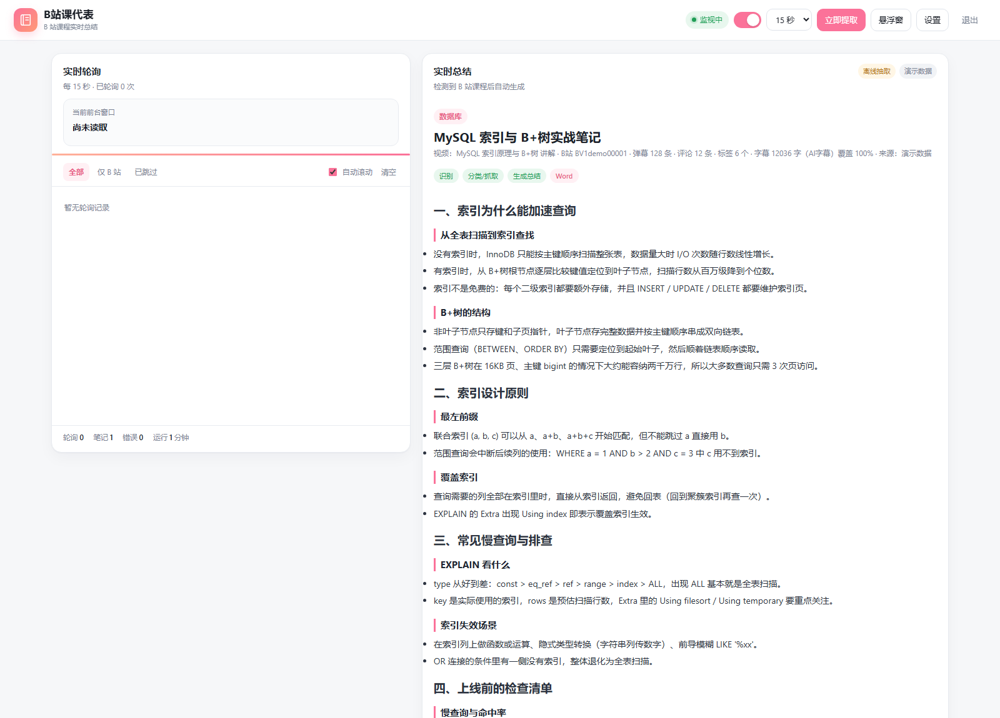
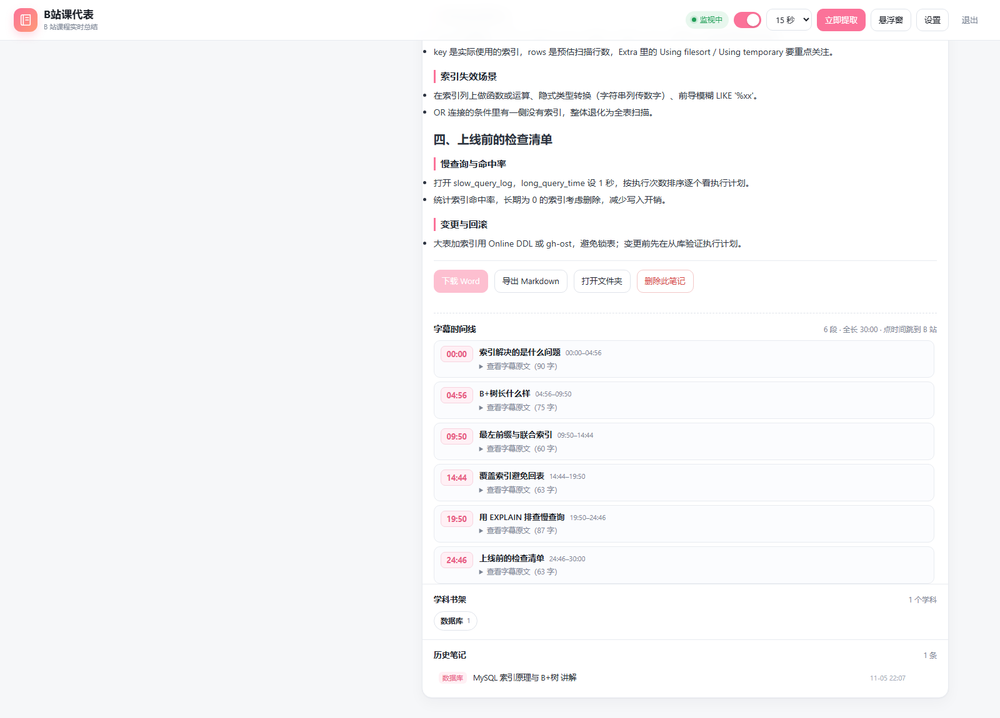

# bili-course-rep — Bilibili Course Notes

[中文](README.md) | English

> **Your class rep for Bilibili courses — watch, and the notes write themselves.**

Watching a course on Bilibili? This app detects the video from your foreground window, files it by subject, pulls the description / danmaku / comments / **AI subtitles**, and turns them into a **structured knowledge note** (chapters → topics → bullet points). Export to Word or Markdown; the web UI also shows a **subtitle timeline** — click a timestamp to jump back to that moment on Bilibili.

> A local, single-user app: it only listens on `127.0.0.1` and needs no cloud service. The model can be DeepSeek (or any OpenAI-compatible API), a local Ollama model, or no model at all (extractive fallback).



---

## Features

- **Auto-detection**: polls the Windows foreground window title; a video is accepted after N consecutive stable polls. Background tabs, VMs and remote desktops are not seen.
- **Material fetching**: Bilibili description, tags, danmaku (up to 150), top comments, and manual / AI subtitles (login required).
- **Subtitle completeness**: coverage is checked against the video duration (last cue time ÷ duration) and re-fetched when partial; long transcripts are summarised in chunks so the note covers the whole video.
- **Note format**: one concise title (~20 CJK characters) plus multi-level chapters / topics / bullets. No metadata, no danmaku, no raw transcript, no mind map.
- **Subtitle timeline**: logical segments (~3–4 minutes each) with start time, a short title and the original subtitle text; clicking the time opens Bilibili at that second.
- **Export**: Word (python-docx) and Markdown (a copy is also kept next to the subject folder).
- **Workflow**: pending-confirmation queue, ignore list, archiving on delete (recoverable), per-subject study manual, course overview.
- **Extras**: always-on-top mini window (Document Picture-in-Picture), compact mode.



## Requirements

| Dependency | Notes |
| --- | --- |
| Windows 10 / 11 | Foreground-window polling uses PowerShell; shortcuts use `wscript`. macOS / Linux are not supported |
| Node.js ≥ 18 | Node 18 is enough for the app; the test scripts use recursive directory reads, so 20+ is recommended |
| Python 3 | Only for Markdown → Word; install `python-docx` to get `.docx` output |
| A model (optional) | DeepSeek API key, or local Ollama; without either the app falls back to offline extraction |

```bash
pip install -r requirements.txt
```

## Quick start

1. Clone or unzip the repo anywhere;
2. `pip install -r requirements.txt` (only needed for Word export);
3. **Double-click `app\launch.vbs`** (starts in the background and opens the page), or run `node app\server.mjs`;
4. Open <http://127.0.0.1:8765>;
5. Open **Settings** and configure the model and your Bilibili session (see below).

> Prefer `app\launch.vbs` or a desktop shortcut (the server runs hidden). Do not keep the server attached to a terminal that will be closed.
> The default port is `8765`: if you change `port` in `config.json`, update the `url` in `app\launch.vbs` as well.

### Bilibili login (required for AI subtitles)

1. Log in to Bilibili in a browser → `F12` → Application → Cookies → `https://www.bilibili.com`;
2. Copy the `SESSDATA` value;
3. Paste it into **Settings → B站 字幕** and click **测试字幕**; it should report "已登录".

The cookie is stored only in `课程知识地图\.state\bili-auth.json` on your machine and can be cleared from Settings. It is never written into notes.

### Model configuration

- `auto` (default): use DeepSeek when an API key exists, otherwise Ollama; otherwise offline extraction;
- `deepseek`: Base URL (default `https://api.deepseek.com/v1`), model name (e.g. `deepseek-chat`) and API key;
- `ollama`: local `http://127.0.0.1:11434/v1` (pre-pull a model, e.g. `ollama pull qwen2.5:3b`);
- `extractive`: no model at all — a structured summary from description / tags / danmaku / comments.

The key can also be supplied via the `DEEPSEEK_API_KEY` environment variable (a key saved in Settings takes precedence).

## Usage

1. Play a Bilibili course in another window and keep it in the foreground;
2. When detected, the video enters the **pending** list with its BV id, subtitle length/source, and danmaku/comment counts;
3. Click **生成笔记**, or use **立即提取** in the top bar (when the foreground is not Bilibili, it falls back to the video detected within the last 45 minutes);
4. When generation finishes:
   - read the note on the right; the **subtitle timeline** below helps you locate content;
   - **导出 Markdown** or **下载 Word**;
   - **打开文件夹** / **删除此笔记**.

## Output layout

```
课程知识地图\
├── 课程总览.docx
├── 学习进度.md
├── _archive\deleted\            # deleted notes (recoverable)
├── <subject>\
│   ├── 学习手册.docx            # accumulated subject manual
│   ├── <video title>.docx
│   └── <video title>.md
└── .state\
    ├── state.json               # subjects, dedup keys, pending, ignore list
    ├── bili-auth.json           # Bilibili cookie (local only)
    ├── videos\<video>.md        # per-video Markdown source
    ├── notes\<video>.json       # per-video metadata (BV, lengths...), not in the note
    ├── timelines\<video>.json   # subtitle timeline, web UI only
    ├── manuals\<subject>.md
    └── poll.log                 # polling / classification / fetch log
```

A note contains only its title and knowledge points; metadata and timelines live in `notes/` and `timelines/` so they never pollute Word or Markdown.

## Data & privacy

- The server binds to `127.0.0.1` only;
- Requests go only to Bilibili and the model endpoint you configure — nothing else;
- The Bilibili cookie is stored locally in `.state/bili-auth.json`; the API key is stored in **plain text** in `app/config.json`;
- `app/config.json`, `课程知识地图/` and `app/logs/` are listed in `.gitignore` — **never commit them**;
- Deleted notes are moved to `_archive/deleted` and can be restored from the filesystem.

## Known limitations

- **Windows only**: foreground-window polling and shortcut creation rely on Windows components;
- The Bilibili subtitle/comment endpoints are **unofficial** and require a login; they may break, rate-limit, or trigger risk control. Use responsibly, for personal study, and respect Bilibili's terms;
- Long videos (>30 min) take 1–2 minutes and consume model tokens;
- Without `python-docx` only Markdown is produced;
- Only the **foreground** window is read; background tabs, VMs and remote desktops are invisible.

## Development

- Engine: `app/engine/lib/index.js` (single-file ESM, Node built-ins only);
- Frontend: `app/public/` (refresh the page after changes — no restart needed);
- Host: `app/server.mjs` (HTTP + SSE + engine host);
- Tests:

```bash
node tools/test/subtitle-split.test.mjs
node tools/test/generate.test.mjs
node tools/test/timeline.test.mjs
node tools/test/delete-confirm.test.mjs
node tools/test/reconcile.test.mjs
node tools/test/title.test.mjs

# optional network smoke tests (need a Bilibili session: BILI_SESSDATA or a saved cookie)
node tools/test/bili.test.mjs "video title"
node tools/test/subtitle-probe.mjs BV1xxxxxxxxx
```

## License

[MIT](LICENSE). The engine and the Word conversion script are modified from [dsh-video-coursemap](https://github.com/linner1224/dsh-video-coursemap) (MIT); see [THIRD_PARTY_NOTICES.md](THIRD_PARTY_NOTICES.md).
