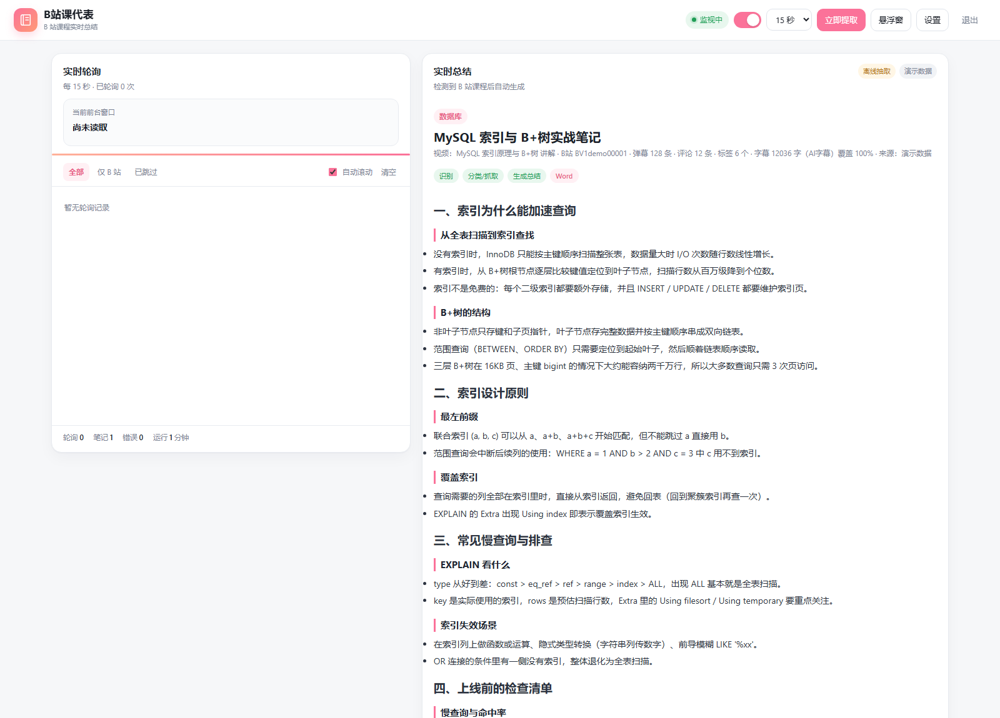
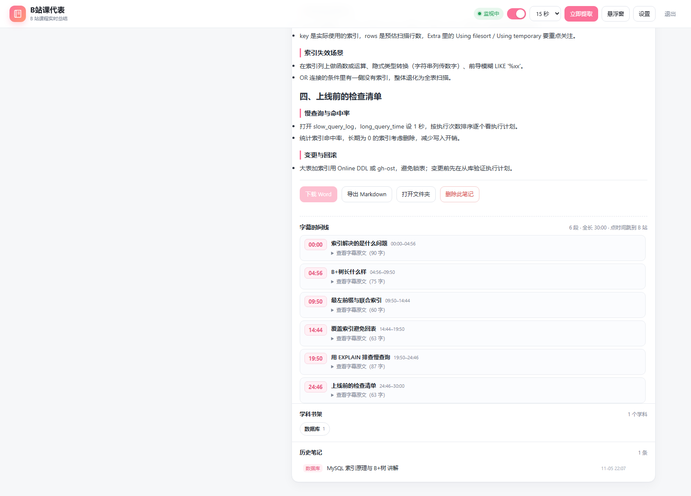

# B站课代表 · bili-course-rep

中文 | [English](README.en.md)

> **课照看，笔记它来记。**

看 B 站课程时自动识别当前视频，按学科归档，抓取简介 / 弹幕 / 评论 / **AI 字幕**，用大模型生成**结构化的核心知识点笔记**（章节 → 主题 → 要点），可导出 Word / Markdown；网页里还提供按时间切分的**字幕时间线**，点时间即可跳回 B 站对应位置。

> 本地单机应用：只监听 `127.0.0.1`，不需要任何云服务；模型可以用 DeepSeek 等 OpenAI 兼容 API，也可以用本地 Ollama，甚至离线抽取。



---

## 功能

- **自动识别**：轮询 Windows 前台窗口标题，连续 N 次稳定后判定为 B 站课程视频；不认后台标签页 / 虚拟机 / 远程桌面
- **素材抓取**：B 站简介、标签、弹幕（≤150 条）、热评；需要登录态的人工字幕 / AI 字幕
- **字幕完整性**：按「末条时间戳 ÷ 视频时长」校验覆盖度，不足自动重抓；长字幕分段提炼，笔记覆盖全片
- **笔记格式**：只有一个概括标题（约 20 字）+ 多级章节/主题/要点；不含元数据、弹幕、字幕原文、思维导图
- **字幕时间线**：按逻辑段落（约 3~4 分钟一段）展示时间、小标题、字幕原文，点时间跳 B 站
- **导出**：Word（python-docx）、Markdown（同时留一份到学科目录）
- **工作流**：待确认队列、忽略名单、删除归档（可找回）、学科学习手册、课程总览
- **小工具**：置顶悬浮窗（Document PiP）、紧凑模式

字幕时间线（点时间跳到 B 站，展开可看该段字幕原文）：



## 环境要求

| 依赖 | 说明 |
| --- | --- |
| Windows 10 / 11 | 前台窗口读取依赖 PowerShell；快捷方式依赖 `wscript`。macOS / Linux 未适配 |
| Node.js ≥ 18 | 应用本身 18 即可；测试脚本用到递归读取目录，建议 20+ |
| Python 3 | 仅用于 Markdown → Word；装 `python-docx` 后才有 `.docx` |
| 模型（可选） | DeepSeek API Key，或本地 Ollama；都没有时退化为「离线抽取」 |

```bash
pip install -r requirements.txt
```

## 快速开始

1. 把仓库克隆 / 解压到任意目录；
2. `pip install -r requirements.txt`（想用 Word 导出就装）；
3. **双击 `app\launch.vbs`**（后台启动并打开页面），或命令行 `node app\server.mjs`；
4. 浏览器打开 <http://127.0.0.1:8765>；
5. 打开「设置」，配置模型与 B 站登录态（见下）。

> 推荐用 `app\launch.vbs` 或桌面快捷方式启动（后台隐藏运行）；不要把服务挂在会退出的终端里。
> 端口默认 `8765`：改 `config.json` 的 `port` 时，记得同步改 `app\launch.vbs` 里的 `url`。

### 配置 B 站字幕（AI 字幕必需）

1. 浏览器登录 B 站 → `F12` → Application → Cookies → `https://www.bilibili.com`；
2. 复制 `SESSDATA` 的值；
3. 应用「设置 → B站 字幕」粘贴，点「测试字幕」应显示「已登录」。

Cookie 只保存在本机 `课程知识地图\.state\bili-auth.json`，可用设置里的「清除」删除；不会写进笔记。

### 配置模型

- `auto`（默认）：有 API Key 用 DeepSeek，否则用 Ollama；都没有则离线抽取；
- `deepseek`：填 Base URL（默认 `https://api.deepseek.com/v1`）、模型名（如 `deepseek-chat`）、API Key；
- `ollama`：本地 `http://127.0.0.1:11434/v1`，先 `ollama pull qwen2.5:3b`；
- `extractive`：不调用模型，只用简介 / 标签 / 弹幕 / 评论做结构化整理。

Key 也可以放在环境变量 `DEEPSEEK_API_KEY`（优先级低于设置里保存的 Key）。

## 使用流程

1. 在另一个窗口播放 B 站课程，保持它在**前台**；
2. 应用检测到后进入「待确认」：显示 BV 号、字幕字数/来源、弹幕评论数；
3. 点「生成笔记」；或直接点顶部 **「立即提取」**（前台不是 B 站时会用最近 45 分钟内检测到的视频）；
4. 生成完成后：
   - 右侧看笔记；下方「字幕时间线」可定位内容；
   - 「导出 Markdown」或「下载 Word」；
   - 「打开文件夹」「删除此笔记」。

## 输出目录

```
课程知识地图\
├── 课程总览.docx
├── 学习进度.md
├── _archive\deleted\            # 删除的笔记（可找回）
├── <学科>\
│   ├── 学习手册.docx            # 学科累计知识地图
│   ├── <视频标题>.docx
│   └── <视频标题>.md
└── .state\
    ├── state.json               # 学科、去重键、待确认、忽略名单
    ├── bili-auth.json           # B站 Cookie（仅本机）
    ├── videos\<视频>.md         # 单视频 Markdown 源
    ├── notes\<视频>.json        # 单视频元数据（BV、字数、弹幕数…，不进笔记）
    ├── timelines\<视频>.json    # 字幕时间线（网页展示用，不进笔记）
    ├── manuals\<学科>.md
    └── poll.log                 # 轮询/分类/抓取日志
```

笔记正文只有「标题 + 核心知识点」；元数据与时间线分别放在 `notes/`、`timelines/`，不污染 Word / Markdown。

## 数据与隐私

- 服务只绑定 `127.0.0.1`，不对外监听；
- 只向 B 站接口和你选择的模型 API 发请求，不向其他第三方发送数据；
- B 站 Cookie 只存本机 `.state/bili-auth.json`；API Key 存 `app/config.json`（**明文**）；
- `app/config.json`、`课程知识地图/`、`app/logs/` 已在 `.gitignore` 中排除，**不要提交**；
- 删除笔记默认移入 `_archive/deleted`，可在文件夹找回。

## 已知限制

- **仅 Windows**：读取前台窗口、创建快捷方式依赖 Windows 组件；
- B 站字幕/评论接口**非官方**、需要登录态，可能失效、限流或触发风控；请遵守 B 站服务条款，仅用于个人学习；
- 长视频（>30 分钟）生成约 1~2 分钟，会消耗模型 token；
- 没有安装 `python-docx` 时只会生成 Markdown；
- 只读取**前台**窗口，后台标签页、虚拟机、远程桌面内播放读不到。

## 开发

- 引擎：`app/engine/lib/index.js`（单文件 ESM，只用 Node 内置模块）；
- 前端：`app/public/`（改完刷新页面即可，无需重启）；
- 宿主：`app/server.mjs`（HTTP + SSE + 引擎宿主）；
- 测试：

```bash
node tools/test/subtitle-split.test.mjs
node tools/test/generate.test.mjs
node tools/test/timeline.test.mjs
node tools/test/delete-confirm.test.mjs
node tools/test/reconcile.test.mjs
node tools/test/title.test.mjs

# 联网冒烟（可选，需要 B站登录态：BILI_SESSDATA 或已配置的 Cookie）
node tools/test/bili.test.mjs "视频标题"
node tools/test/subtitle-probe.mjs BV1xxxxxxxxx
```

## 许可

[MIT](LICENSE)。引擎与 Word 转换脚本修改自 [dsh-video-coursemap](https://github.com/linner1224/dsh-video-coursemap)（MIT），详见 [THIRD_PARTY_NOTICES.md](THIRD_PARTY_NOTICES.md)。
