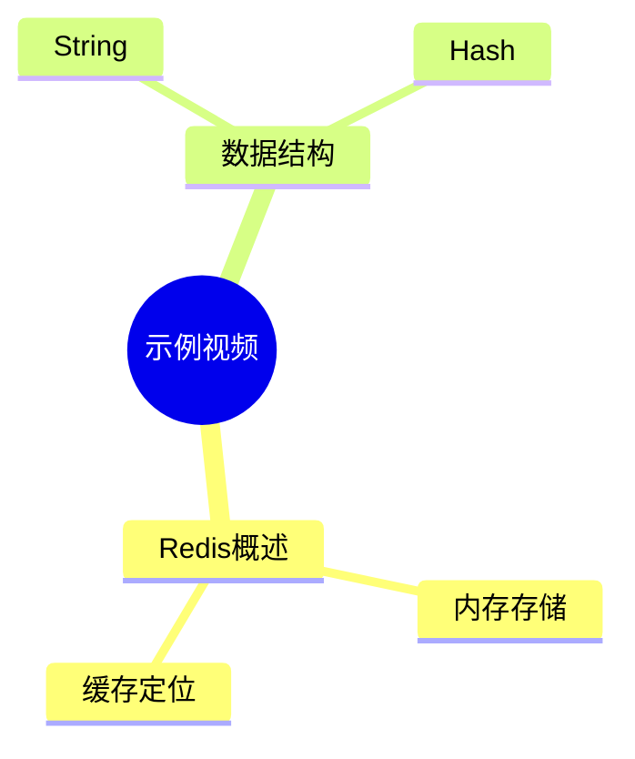

# 示例视频

- 学科：测试
- 关键词：Redis、缓存

## 示例视频

> 一句话简介：用于验证 Word 转换链路。

### 核心知识点
- **Redis 概述**
  - 内存键值数据库
  - 常用作缓存
- **数据结构**
  - String
  - Hash

### 弹幕与评论讨论焦点
- 缓存穿透怎么处理
- Redis 和 MySQL 的区别

### 思维导图

